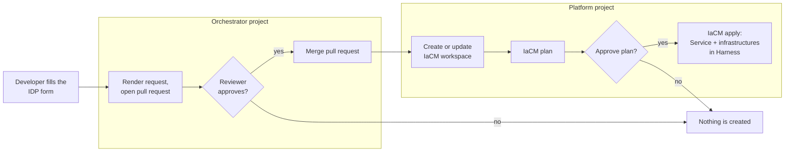

# Harness IDP service request


A self-service way for a developer to ask for a new **Harness CD Service**, the **Infrastructure Definitions** it deploys to, and an optional **deployment pipeline** from a form in the Harness Internal Developer Portal (IDP). The request becomes plain YAML files in a pull request. After a reviewer approves, the files are merged and OpenTofu makes Harness match them.

Two service types are included today: **Google Cloud Run** and **Native Helm deployment**. Service and infrastructure rendering use two templates per type. Deployment pipeline inputs live in one shared template.

## Contents

- [The idea](#the-idea)
- [How a request flows](#how-a-request-flows)
- [Repository layout](#repository-layout)
- [The pieces and how they are used](#the-pieces-and-how-they-are-used)
- [Prerequisites](#prerequisites)
- [Values you must replace](#values-you-must-replace)
- [Getting started](#getting-started)
- [Adding a service type](#adding-a-service-type)
- [Testing](#testing)
- [Next steps](#next-steps)
- [References](#references)
- [Contributing](#contributing)

## The idea

The work is split between two owners.

| Who | Owns | How |
| --- | --- | --- |
| Platform team | The **project baseline**: the Harness project, its environments (for example `dev`, `staging`, `prod`) and its connectors (cloud, Git, cluster) | Out of scope here. Any project bootstrap works. |
| Developer | A **Service**, one **Infrastructure Definition per environment**, and an optional **deployment pipeline** | One IDP form. This repository. |

Design choices:

- **Git is the source of truth.** A request reads connector and template metadata, then writes a Service config, one infrastructure config per environment and an optional pipeline config. Harness is then reconciled from those files.
- **One infrastructure per Service and environment.** The developer does not pick a shared infrastructure; the request creates the Service's own. To retire a Service and its associated resources, remove their Service, infrastructure and pipeline configs and review the resulting destroy plan.
- **A service type is a pair of templates.** `cloudrun` and `helm` are folders with a `service.tpl` and an `infrastructure.tpl`. The Service and infrastructure modules discover these types. Pipeline requests use the shared `templates/pipeline.tpl`.
- **Works without IDP.** The form is one way in. The same files can be added by pull request and applied by the same workspace.
- **Review before anything exists.** The request opens a pull request and the run waits for an approval. Nothing is created in Harness until the files are merged and the plan is approved.
- **Two projects, two jobs.** An orchestrator project receives requests and only needs to write to Git. A platform project owns the IaCM workspaces and the token that creates resources. The pull request is the hand-over between them.

## How a request flows



1. **Form.** The developer picks the project and the service type, fills in the type's fields and adds one row per environment.
2. **Render.** The Service Request pipeline turns the form values into the module's request shape and runs a file-only OpenTofu apply. It writes the new YAML files and touches nothing in Harness.
3. **Pull request.** The files are pushed to a branch named `request/<org>/<project>/<service>` and a pull request is opened, using a short-lived GitHub App token.
4. **Review.** The run waits at a Harness approval that links to the pull request. No build machine runs while it waits.
5. **Merge.** After approval the pipeline merges the pull request, or accepts that a reviewer already merged it, and deletes the branch.
6. **Reconcile.** The run chains the Project Service Reconcile pipeline in the platform project. It creates the project's IaCM workspace if it is missing (one workspace, and so one state, per consumer project), then plans, waits for approval and applies.

The workspace never sees the request. It only reconciles what main records, so the reconcile pipeline can also be run on its own after a file is changed by hand.

## Repository layout

```
.
├── workflows/
│   └── request-service.yaml            IDP form (Workflow) that triggers Service Request
├── pipelines/
│   ├── service-request.yaml            Orchestrator project: render, pull request, approval, merge, chain reconcile
│   ├── project-service-reconcile.yaml  Platform project: workspace, plan, approve, apply. No request.
│   ├── inputsets/                      Helm and Cloud Run end-to-end request tests
│   └── templates/
│       ├── configure-workspace.yaml    Account-level stage template that creates the IaCM workspace
│       ├── service-request-native-helm-deploy.yaml Account Pipeline Template: Native Helm deployment
│       ├── service-request-helm-deploy.yaml       Legacy Kubernetes template for existing consumers
│       └── service-request-cloudrun-deploy.yaml   Account Pipeline Template: Cloud Run deployment
├── tofu/                               OpenTofu root the IaCM workspace runs
│   ├── main.tf, variables.tf, ...
│   ├── workspace.tfvars                Settings shared by every workspace run
│   ├── request.auto.tfvars.example     A local test request
│   ├── modules/
│   │   ├── harness-services/           Reads and writes service files, manages harness_platform_service
│   │   ├── harness-infrastructures/    Same for infrastructure files and harness_platform_infrastructure
│   │   ├── harness-pipelines/          Renders saved configs and manages inline project pipelines
│   │   └── templates/
│   │       ├── pipeline.tpl            Shared deployment pipeline config
│   │       └── <type>/                 service.tpl and infrastructure.tpl per service type
│   ├── tests/                          Mocked plan tests and local plan values example
│   └── configs/                        The config files: the source of truth (example content)
└── workspace-bootstrap/                OpenTofu used by the stage template to create the workspace
```

## The pieces and how they are used

### Config files (`tofu/configs/`)

The files Harness is reconciled from, one tree per consumer project:

```
configs/organizations/<org>/projects/<project>/
├── services/<type>/<service_identifier>.yaml
├── infrastructures/<environment>/<service_identifier>.yaml
└── pipelines/<service_identifier>_deploy.yaml
```

Each file holds a few fields the module reads (`name`, `tags`, the type) and the Harness YAML under `yaml:`. The files in this repository are example output for a Service called `orders_api`. They are written by the pipeline, and they can also be edited by hand.

### OpenTofu root and modules (`tofu/`)

- **`modules/harness-services`** finds every service file for the project, optionally renders new ones from a request, and declares one `harness_platform_service` per file.
- **`modules/harness-infrastructures`** does the same for infrastructure files and `harness_platform_infrastructure`.
- **`modules/templates/<type>/`** holds the two templates of a type. The folder name is the type name.
- **`modules/harness-pipelines`** reads saved pipeline configs, renders optional requests through the shared `modules/templates/pipeline.tpl`, and declares `harness_platform_pipeline`.
- **The root** wires all three modules to a project folder and passes the request through.

A request is one variable, `services`, grouped by type:

```hcl
services = {
  cloudrun = {
    orders_api = {
      name  = "orders-api"
      owner = "group:account/orders"
      config = {                       # read by templates/cloudrun/service.tpl
        git = { connector_ref = "account.generic", repository = "orders", path = "deploy/service.yaml" }
      }
      infrastructure = {               # one entry per environment
        dev = { connector_ref = "gcpproject", project = "my-gcp-project-dev", region = "europe-west2" }
      }
    }
  }
}
```

Two behaviours matter:

- **Every existing file is always declared.** A file already in Git is passed through as it is; only a requested Service is rendered. Adding a second Service therefore never touches the first.
- **`write_files`** decides whether files are written to disk. It is `true` for the render step and for local runs, and `false` in the IaCM workspace (`workspace.tfvars`), where the files already come from Git.

Guards stop a run early with a clear message for an unknown type, an identifier used under two types, or a file whose content does not match its folder.

### Pipelines (`pipelines/`)

The supported request path is the reviewed path (`service-request.yaml` and `project-service-reconcile.yaml`).

`Service Request` lives in the orchestrator project (`idp_orchestrator`) and is what the form triggers.

| Stage | What it does |
| --- | --- |
| **Serialize Project Requests** | A queue keyed by organization, project and Service. Different Services run in parallel, also while one waits for approval. |
| **Publish Request** | Turns each connector the form picked into a scoped reference and checks it in Harness (see [Connectors at any scope](#connectors-at-any-scope)). Fails if the requested Service already exists in the project (unless the run was started by hand with `allow_update = true`). Clones the config repository, builds the request JSON from the pipeline variables with `jq`, runs a targeted, file-only `tofu apply` with a throwaway state, pushes a request branch and opens a pull request. |
| **Review Request** | A Harness approval whose message links to the pull request. Swap it for a Jira approval if that is where your reviews live. |
| **Merge Request** | Merges the pull request, or accepts a merge a reviewer already made, and deletes the branch. Fails if the pull request was closed unmerged. |
| **Reconcile Project** | Chains `Project Service Reconcile` in the platform project. |

Run it with `request_action = reconcile` to skip straight to the last stage and only reconcile a project.

`Project Service Reconcile` lives in the platform project (`platform_management`), next to the IaCM workspaces. It carries no request: **Configure Project Workspace** uses the stage template to create or update the workspace `project_service_bootstrap_<org>_<project>`, pointing at `tofu/` in the config repository on the main branch, and **Reconcile Project** runs IaCM init, plan, manual approval and apply. Harness does not allow a chained pipeline to chain another, so keep it a leaf.

The pull request is opened with an installation token of a GitHub App, made inside the step from the App's private key (a Harness file secret) and thrown away afterwards. No personal token is stored.

The two input sets in `pipelines/inputsets/` test `Service_Request` in `idp_orchestrator` end-to-end without IDP. They include template selection and stop at a reconcile plan after the request PR is approved and merged. See [Testing](#testing).

The `service_*` pipeline variables are the request contract: `service_config` is the JSON the service template reads, and `service_infrastructure` is either a map keyed by environment or the form's shape, a connector once and/or one per row plus a list of environment rows, which the render step converts to that map. The form sends each connector as `{"connector": {"identifier", "org", "project"}}`; Service Request replaces it with `connector_ref` and `connector_type` before rendering.

### Workspace stage template (`pipelines/templates/` and `workspace-bootstrap/`)

`Configure_Service_Request_Workspace` `v1` is an account-level stage template. It clones this repository, runs the small OpenTofu root in `workspace-bootstrap/iacm-workspace`, shows a plan, asks for approval and creates or updates the IaCM workspace, including its variables, its variable file and its secret reference. Secrets are always passed as Harness secret references, never as values.

### IDP form (`workflows/request-service.yaml`)

A Harness IDP 2.0 Workflow. It lists real objects from the chosen project (environments, connectors and, for Cloud Run, the GCP projects the connector can see) and triggers the Service Request pipeline.

#### Connectors at any scope

Every connector field is a dropdown, filled with the developer's own token, of the connectors of its type that the developer can view in the project, its organization and the account. There is no free-text connector field, and no connector at any particular scope is assumed. An empty list means the developer can view no connector of that type at any of the three scopes; the field's description says to ask the platform team or create one in the project.

A connector's identifier carries no scope. Source connector dropdowns and the shared Cloud Run connector copy the chosen connector's organization and project into two read-only fields next to it. Helm's per-row cluster picker is resolved separately as described below. Service Request builds the reference from the three values: a project connector keeps its bare identifier, an org connector becomes `org.<id>`, an account connector becomes `account.<id>`. It then reads each reference back from Harness and stops with a clear message if the connector is missing or has the wrong type. If a connector arrives without its project (or without both organization and project), it also looks the identifier up in the narrower scopes and stops if it exists there too, because the form did not say which one was picked. A Harness answer other than "found" or "not found", such as a denied request or a network error, also stops the run. The Helm chart repository may be an HTTP or an OCI Helm connector; the type read back chooses the chart store.

Helm uses a repeatable **Environments** list. Each row selects an environment, a Kubernetes cluster and a namespace. Add or remove rows as needed, reuse a cluster in multiple environments, or choose different clusters. There are no fixed Dev/Staging/Prod slots and no shared-cluster mode selector. The cluster ID is stored in the row, without global context fields. Service Request checks all three scopes and accepts only a unique match with the Kubernetes connector type. If an ID exists at multiple scopes, the request stops and asks the platform team to give the connectors distinct identifiers; it never guesses a scope. Cloud Run keeps one GCP connector above its repeatable environment/project/region rows. Duplicate environments are rejected for both types. Cloud Run's GCP project lookup uses the same scope metadata to send a bare, `org.` or `account.` connector reference. A GCP project ID can still be entered manually if the connector cannot list it.

**Permissions.** The dropdowns show what a developer can **view** (`core_connector_view`). Deploying through a connector needs **Access** (`core_connector_access`) for whoever runs the deployment. Grant the two together, for example in one "connector consumer" role with View and Access bound to the same resource group, and never View alone; then what developers see is what they can use. Service Request reads connectors with the same API key IDP triggers it with (`account.idp_service_requests_token`), so that key's service account needs connector View in the consumer projects, their organizations and the account.

### Optional project deployment pipelines

The **Create a deployment pipeline** checkbox defaults to false. When checked, the workflow lists stable account Pipeline Templates filtered by `service_type` and sends `pipeline_template`. The request resolver checks account scope, Pipeline type and the service-type tag, then pins the current stable `versionLabel` in Git. The request token needs account Template View permission.

`service_identifier` remains the public field and pipeline variable. It becomes the `services.<type>.<identifier>` map key. The pipeline module uses that key as its internal `service_id`, names the pipeline `<service_identifier>_deploy`, and binds the account template's `service_identifier` input. There is no new caller-facing `service_id` field.

The shared `tofu/modules/templates/pipeline.tpl` renders the config into the same PR as the Service and infrastructure files. The render step targets local files only. Reconciliation creates an inline Harness project pipeline after its Service and infrastructure. Leaving the checkbox off preserves saved pipelines; deleting a pipeline config explicitly plans removal of that pipeline.

The bundled account templates define these runtime inputs:

| Template | Bound by the request | Chosen when deploying |
| --- | --- | --- |
| `service_request_native_helm_deploy` | `service_identifier` | `environment_identifier`, reviewed `git_commit` for the values file |
| `service_request_cloudrun_deploy` | `service_identifier` | `environment_identifier`, `runner_connector_ref`, `runner_namespace`, Deploy stage `serviceInputs` |

Creating a pipeline does not run it or deploy a workload. A matching tag alone does not guarantee compatible inputs: update the shared `pipeline.tpl` before selecting another template contract. A new stable version does not automatically update the versions already pinned in saved configs. The Native Helm example uses `HelmDeploy` and `HelmRollback`; it is a rolling deployment template.

### Native Helm deployment

The workflow offers **Google Cloud Run** and **Helm Deployment**. New `helm` requests use `NativeHelm` for both the Service and infrastructure deployment type. The connection type stays `KubernetesDirect`. Chart repositories, values files and the runtime Git commit input are unchanged.

Register `service_request_native_helm_deploy` at account scope with version `v1`, mark it stable, and select **Service Request Native Helm Deploy** for new Helm requests. Native Helm uses Helm install/upgrade and Helm rollback, including chart hooks; the previous Kubernetes approach rendered charts and let Harness apply and track the resources.

The legacy `pipelines/templates/service-request-helm-deploy.yaml` is retained for existing Kubernetes consumers. Do not select or register it for new Native Helm requests. Existing saved configs and pinned pipeline references are not migrated automatically. Use a fresh Service identifier and a separate, existing test namespace: changing the deployment type does not transfer existing Kubernetes resources into a Helm release.

A separate Kubernetes deployment option is still being tested in the private examples repository and is not included here. These changes are repository files only; updating a live Harness workflow or registering templates is a separate action.

## Prerequisites

- A Harness account with **IDP**, **CD** and **IaCM**.
- A consumer project with its environments and connectors already created (the project baseline).
- An orchestrator project (`idp_orchestrator`) for `Service Request` and a platform project (`platform_management`) for the reconcile pipeline and the IaCM workspaces. One project can play both roles.
- A GitHub App installed on your copy of this repository with read and write access to contents and pull requests, and its private key stored as a Harness file secret. The same App can back your Git connector.
- A Git connector that can read and push to your copy of this repository.
- A Kubernetes connector for the step that runs the workspace bootstrap, and a container registry connector for the OpenTofu image.
- A Harness API token, stored as a Harness secret, that can manage Services, Infrastructure Definitions and IaCM workspaces. For pipeline requests, the managing token also needs project Pipeline management and account Template View. A second secret, at account scope, holds the token IDP uses to trigger the pipeline; Service Request uses it to read connectors and account Pipeline Templates.
- Locally, only for testing: [OpenTofu](https://opentofu.org) 1.9 or newer.

## Values you must replace

The YAML files carry example values. Search and replace these before importing anything.

| Value in the files | What it is |
| --- | --- |
| `YOUR_ACCOUNT_ID` | Your Harness account id in the workflow URLs and account-template picker parameters/body |
| `harness_platform_accelerator` / `idp_orchestrator` | Organization and project that hold `Service Request` |
| `harness_platform_accelerator` / `platform_management` | Organization and project that hold `Project Service Reconcile` and the IaCM workspaces |
| `harness-landing-zone` / `harness-idp-service-request` | GitHub organization and the config repository the pipelines clone, push to and open pull requests in |
| `tofu` | OpenTofu root in the config repository; the request pipeline and workspace both use it |
| `account.generic` | Git connector used to clone and push |
| `YOUR_GITHUB_APP_ID` / `YOUR_GITHUB_APP_INSTALLATION_ID` | ID and installation ID of the GitHub App that opens and merges pull requests |
| `account.github_app_private_key` | File secret holding that App's private key |
| `account.DockerHub` | Container registry connector |
| `hubcluster` | Kubernetes connector that runs the workspace bootstrap step |
| `https://app.harness.io/gateway` | Harness API endpoint Service Request reads connectors and templates from |
| `harness_platform_accelerator_platform_deployer_token` | Secret holding the Harness API token |
| `idp_service_requests_token` | Account-scope secret IDP uses to trigger the pipeline; Service Request reads connectors and account templates with it |
| `account.platform_approvers` | User group that approves requests and workspace changes |
| `example_org` / `example_project`, `gcpproject`, `my-gcp-project-*`, `podinfo_helm_repo`, `shared_k8s_cluster` | Example consumer project, connectors and GCP project ids in the troubleshooting input sets and example config files |

## Getting started

**1. Try the module locally.** No Harness objects are created by the first command; it only writes files.

```bash
cd tofu
cp request.auto.tfvars.example request.auto.tfvars
export HARNESS_ACCOUNT_ID=... HARNESS_PLATFORM_API_KEY=...
export TF_VAR_organization_identifier=example_org TF_VAR_project_identifier=example_project
tofu init
tofu apply -target=module.harness_services.local_file.rendered -target=module.harness_infrastructures.local_file.rendered -target=module.harness_pipelines.local_file.rendered
```

A full `tofu plan` then shows the Services, Infrastructure Definitions and any requested deployment pipelines for the project. For a plan-only example with a pipeline, use `tofu/tests/plan.tfvars.example` as described below.

**2. Register the stage template** `pipelines/templates/configure-workspace.yaml` at account level as `Configure_Service_Request_Workspace` `v1`.

**3. Register deployment templates.** For pipeline requests, register `pipelines/templates/service-request-native-helm-deploy.yaml` and `service-request-cloudrun-deploy.yaml` as account-level Pipeline Templates at `v1`, then mark those versions stable. Review their connector references first. Helm uses Native Helm deployment; Cloud Run uses a Kubernetes runner and the `account.DockerHub` connector for its plugin images.

**4. Register reconciliation.** Register `pipelines/project-service-reconcile.yaml` in `platform_management` as `Project_Service_Reconcile`.

**5. Add the reviewed path.** Register `pipelines/service-request.yaml` in `idp_orchestrator` as `Service_Request`. Optionally import the two `example-project-request-*` input sets to test connector resolution and pull requests without IDP.

**6. Register the workflow** `workflows/request-service.yaml` in IDP and submit a request. The secret it names must hold a token that may execute pipelines in the orchestrator project and view connectors in the consumer projects, their organizations and the account, and view the account Pipeline Templates.

## Adding a service type

1. Create `tofu/modules/templates/<type>/service.tpl` and `infrastructure.tpl`. Copy an existing pair and change the Harness YAML; the header comment of each template lists the values it reads.
2. Add the type to the `service_type` list in the form, with a branch for its fields. Give its list of environments its own field name.
3. Extend the two `| dump` expressions in the form's trigger step so the new type's values are sent.
4. If the type supports pipeline requests, adapt the shared `modules/templates/pipeline.tpl` to the account template's runtime input contract.

## Next steps

Optional deployment pipeline creation is included. Further enhancements, roughly in this order:

1. **Deploy from IDP.** A second workflow that lists the Services of a project and runs that pipeline, so a developer can request a Service and deploy it without leaving the portal.
2. **Add an environment to an existing Service**, as its own small request.
3. **Render and pull request as account-level templates**, so the orchestrator pipeline only references them and other teams can own the render for their request types.
4. **Config repository as a pipeline value**, so one orchestrator can serve several config repositories.
5. **Fewer approvals**: skip the plan approval when a plan only adds resources, or outside production projects. Optionally a Jira approval in place of the Harness one.
6. **Scope each infrastructure to its Service**, environment overrides, and an IDP catalog entry for every Service.
7. **Short-lived environments** through IDP Environment Blueprints, for previews that should not live in Git.

## References

Harness documentation:

- [Internal Developer Portal](https://developer.harness.io/internal-developer-portal) – Workflows, the `trigger:harness-custom-pipeline` action and dynamic pickers
- [IDP Environment Management](https://developer.harness.io/internal-developer-portal/use-idp/environment-management/overview) – Environment Blueprints, short-lived and long-lived environments
- [Continuous Delivery](https://developer.harness.io/continuous-delivery) – Services, environments, Infrastructure Definitions, Google Cloud Run and Helm deployments
- [Infrastructure as Code Management](https://developer.harness.io/infrastructure-as-code-management) – workspaces, workspace templates and the approval step
- [Platform: templates, pipeline chaining, approvals and triggers](https://developer.harness.io/platform)

Tools:

- [Harness Terraform provider](https://registry.terraform.io/providers/harness/harness/latest/docs) – `harness_platform_service`, `harness_platform_infrastructure`, `harness_platform_pipeline`, `harness_platform_workspace`
- [OpenTofu](https://opentofu.org/docs)
- [GitHub Apps: authenticating as an installation](https://docs.github.com/en/apps/creating-github-apps/authenticating-with-a-github-app/authenticating-as-a-github-app-installation) and the [pull requests API](https://docs.github.com/en/rest/pulls/pulls)

Community examples for IDP workflows:

- [harness-community/idp-samples](https://github.com/harness-community/idp-samples)
- [harness-community/IDP-tidbits-Creating-Dynamic-Workflows](https://github.com/harness-community/IDP-tidbits-Creating-Dynamic-Workflows)

## Contributing

Issues and pull requests are welcome, including ones that challenge the design. If you try this in your own account, the most useful feedback is where the setup steps were unclear and which values you had to change that are not in the table above.


## Testing

Run native OpenTofu plan tests from `tofu/`:

```bash
tofu init
tofu test
```

The seven tests cover both deployment template inputs, Native Helm Service and infrastructure types, Helm deploy/rollback steps, preservation when pipeline selection is omitted, invalid scope/version rejection and the root's Service/infrastructure/pipeline handoff. Harness and local providers are mocked; no credentials, live changes or file writes are required. Provider installation still requires `tofu init`.

For a real plan, copy the sanitized values example and edit it for your installation:

```bash
# Run from tofu/.
cp tests/plan.tfvars.example tests/plan.local.tfvars
# Edit tests/plan.local.tfvars and supply your credentials through the environment.
export HARNESS_ACCOUNT_ID=... HARNESS_PLATFORM_API_KEY=...
tofu plan -var-file=tests/plan.local.tfvars
```

The existing `.gitignore` excludes `*.tfvars`; this local file is loaded only when explicitly passed. It uses `write_files=false`. Remove any earlier `request.auto.tfvars` test file if you no longer want it loaded automatically. A fresh local state can show existing resources as creates; use the project reconcile pipeline for a plan against its managed IaCM state, and do not apply a fresh local plan over those resources.

Before testing IDP, import the two input sets into `harness_platform_accelerator / idp_orchestrator / Service_Request`:

| Input set | Service | Environment(s) | Selected account template |
| --- | --- | --- | --- |
| `pipelines/inputsets/example-project-request-helm.yaml` | `podinfo_api` | `dev` | `service_request_native_helm_deploy` |
| `pipelines/inputsets/example-project-request-payments-api.yaml` | `payments_api` | `dev`, `staging` | `service_request_cloudrun_deploy` |

Replace the example consumer project, connectors and source repository settings, register the account templates, and make the reviewed module changes available on your config repository's main branch. Update the request pipeline before importing its input sets so it exposes `pipeline_template`.

Both input sets use `request_action=request`, `tofu_action=plan` and `allow_update=false`. They resolve connectors and the template, generate all three config categories, open a PR, wait for approval, merge and chain the reconcile plan. Plan mode still publishes and merges config changes after approval; workspace setup can also have its own approval and changes. It does not apply the requested Service/infrastructure/pipeline resources or deploy a workload.

Review the PR and plan. After a successful merge, choose a new `service_identifier` for another create test; use `allow_update=true` only when intentionally updating that same test Service. Override `tofu_action` to `apply` for an approved resource-creation test. Once both direct pipeline tests pass, test the requests through IDP.

Repository discovery for the Helm Values repository field remains a separate enhancement pending validation in examples; this release retains its existing text input.
